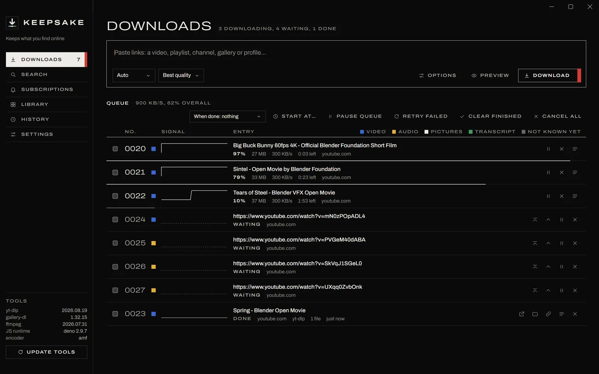

# Keepsake

A free video, audio and gallery downloader for Windows, built on **yt-dlp** and **gallery-dl**. Paste a link from YouTube or more than a thousand other sites, and Keepsake saves it to your Videos, Music or Pictures folder, ready to play.

**[Download KeepsakeSetup.exe](https://github.com/SomethingObvious/keepsake/releases/latest/download/KeepsakeSetup.exe)** for Windows 10 and 11, or see [the website](https://somethingobvious.github.io/keepsake/).



## Install

Open KeepsakeSetup.exe. It installs for your account only and brings its own Python. The installer is not signed, so Windows may ask first: choose More info, then Run anyway. On its first start Keepsake fetches FFmpeg and Deno, which takes under a minute.

## What It Does

* Saves the best quality as it was served, without re-encoding, and removes metadata by default.
* Downloads video, audio, pictures or a clean transcript, with presets and your own.
* Runs a queue that pauses, resumes and retries, and follows channels for new uploads.
* Previews a link first, and Clip downloads only the part you mark. The preview plays small enough for a slow computer.
* Opens downloads in a library with a player that cuts clips, makes GIFs and saves the sound.
* Takes links from a hotkey (Ctrl+Alt+D in any program), bookmarklets or the clipboard.
* Keeps yt-dlp, gallery-dl and itself up to date.

Remove Text, an optional extra set up in Settings, takes captions, stickers and watermarks off a picture: paint over them in the viewer, and a copy is saved beside the picture without them, leaving the original as it was. It is a download of about 46 MB, and nothing of it is fetched until you set it up. [ERASER.md](ERASER.md) has the details.

## Building It

```console
python scripts/install.py
```

That installs a copy that follows `main`, and needs Python 3.12, git, FFmpeg, and Node or Deno. [CONTRIBUTING.md](CONTRIBUTING.md) covers the checks and releases.

## Licence

Keepsake is under the [MIT licence](LICENSE), and what the installer carries keeps its own licence. The screenshot shows Blender Studio's open movies, shared under Creative Commons Attribution. Keepsake is not affiliated with any site it downloads from, so keep only what you have the right to keep.
