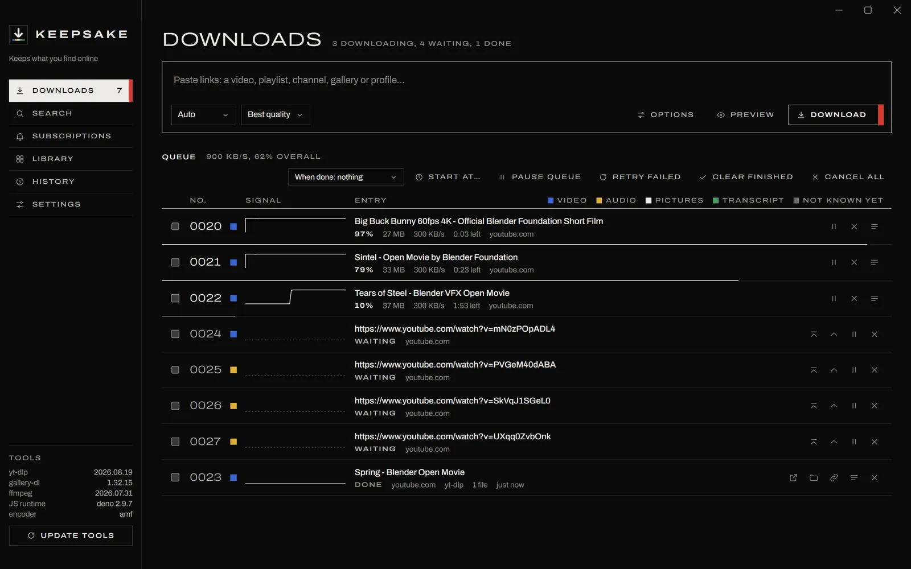
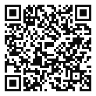

# Keepsake

A free video, audio and gallery downloader for Windows and Android, built on **yt-dlp** and **gallery-dl**. Paste a link from YouTube or more than a thousand other sites, and Keepsake saves it to your Videos, Music or Pictures folder, ready to play.

**[Download KeepsakeSetup.exe](https://github.com/SomethingObvious/keepsake/releases/latest/download/KeepsakeSetup.exe)** for Windows 10 and 11, **[Download Keepsake.apk](https://github.com/SomethingObvious/keepsake/releases/latest/download/Keepsake.apk)** for Android 11 and newer, or see [the website](https://somethingobvious.github.io/keepsake/).



## Install on Windows

Open KeepsakeSetup.exe. It installs for your account only and brings its own Python. The installer is not signed, so Windows may ask first: choose More info, then Run anyway. On its first start Keepsake fetches FFmpeg and Deno, which takes under a minute.

## Install on Android

On the phone, open [Keepsake.apk](https://github.com/SomethingObvious/keepsake/releases/latest/download/Keepsake.apk) (or scan the code below with its camera) and tap the download when it finishes. Android asks once whether your browser may install apps, so allow it and go back. Keepsake is not on the Play Store, so Play Protect may offer to scan it first. On its first start it asks for access to all files, which is how it saves to Movies, Music, Pictures and Documents.

It needs a 64-bit phone with Android 11 or newer. It has the same window and features as on Windows, apart from the hotkey and the tray, and downloads keep going with the app in the background. Install a newer Keepsake.apk the same way to update it, and nothing you have saved is lost.



## What It Does

* Saves the best quality as it was served, without re-encoding, and removes metadata by default.
* Downloads video, audio, pictures, a clean transcript or just the thumbnail, with presets and your own.
* Runs a queue that pauses, resumes and retries, and follows channels for new uploads.
* Previews a link first, and Clip downloads only the part you mark. The preview plays small enough for a slow computer.
* Opens downloads in a library with a player that cuts clips, makes GIFs and saves the sound.
* Takes links from a hotkey (Ctrl+Alt+D in any program), bookmarklets or the clipboard.
* Keeps yt-dlp, gallery-dl and itself up to date.

Remove Text, an optional extra, takes captions, stickers and watermarks off a picture: paint over them in the viewer, and a copy is saved beside the picture without them, leaving the original as it was. Its button is on every picture in the viewer. It is a download of about 46 MB, which the button or Settings offers, and nothing of it is fetched until you set it up.

## Building It

```console
python scripts/install.py
```

That installs a copy that follows `main`, and needs Python 3.12, git, FFmpeg, and Node or Deno. `python scripts/lint.py` runs every check. The Android app builds from [android/](android/README.md).

## Licence

Keepsake is under the [MIT licence](LICENSE), and what the installer carries keeps its own licence. The screenshot shows Blender Studio's open movies, shared under Creative Commons Attribution. Keepsake is not affiliated with any site it downloads from, so keep only what you have the right to keep.
